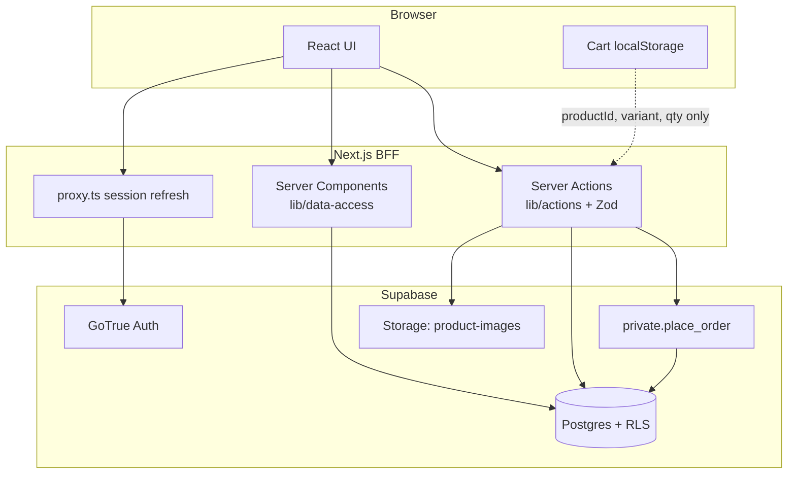
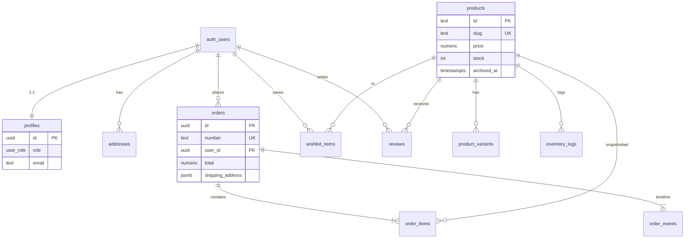
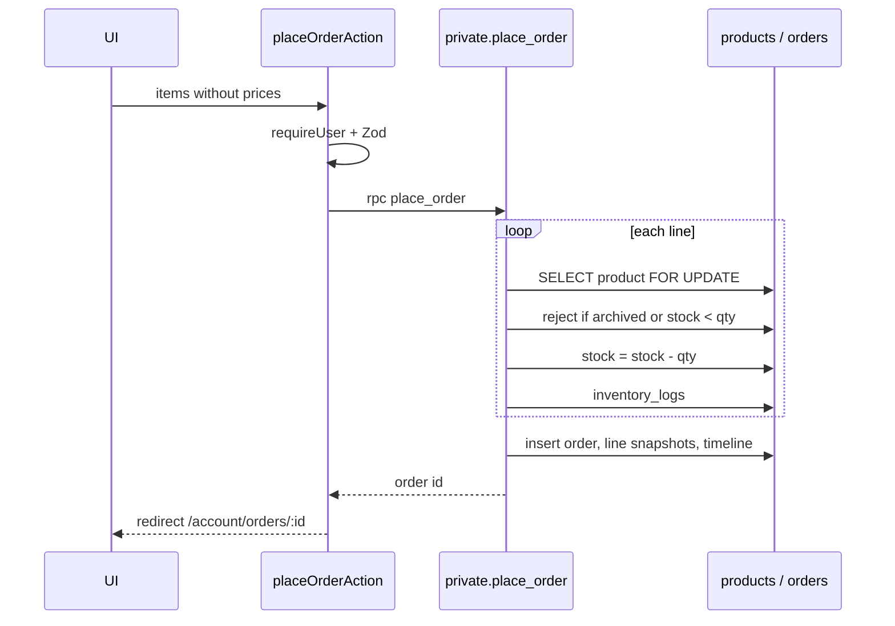

# Nova — Backend, Software Engineering, and Design

> **Current feature catalog:** [FEATURES.md](./FEATURES.md). This document explains layering and integrity. Checkout is **pending → paid via Stripe webhook** (or demo mode), not simulated-as-paid in `place_order`. `/checkout` is public for guests.

Nova is a fullstack e-commerce storefront. The product surface is a Next.js 16 App Router app. The system of record is hosted Supabase (Postgres, Auth, Storage). Payments use Stripe when configured; catalog, identity, orders, stock, reviews, wishlist, and admin operations are real.

This document describes **how the backend is structured**, **why those choices were made**, and **where integrity is enforced**.

---

## 1. Problem and constraints

A storefront cannot trust the browser for money-adjacent state. Prices, stock, order totals, and roles must be decided on the server (or in the database), not copied from `localStorage`.

At the same time, the UI should stay a modern React app: URL-driven catalog filters, a guest cart, and a separate admin console.

Those two requirements drive the design:

| Requirement | Design response |
|-------------|-----------------|
| Do not trust the client for price or stock | Checkout is a single Postgres transaction (`place_order`) |
| Users must only see their own data | Row Level Security (RLS) plus server-side `requireUser` / `requireAdmin` |
| Admins must not be self-appointed | Role lives in `profiles.role`, not in user-editable Auth metadata |
| Guest browsing should stay fast | Catalog reads are public; cart is local until checkout |
| Next.js is the application backend | Browser talks to Server Components / Server Actions, not to Postgres as a write API |

Payment uses Stripe Payment Element + webhooks when keys are present. Without Stripe, **demo mode** still places a pending order and confirms it so inventory/order integrity can be demoed locally.

---

## 2. Architecture

Nova uses a **Backend-for-Frontend (BFF)** shape. Next.js is the only application server. Supabase is the data plane. The browser never holds a service-role key and is not the writer for orders or stock.



**Request path**

1. `proxy.ts` refreshes the Auth cookie on each matched request and redirects unauthenticated users away from `/account` and `/admin`. `/checkout` stays public for guests.
2. Server Components load data through `lib/data-access/*` using a cookie-bound Supabase client.
3. Mutations go through Server Actions in `lib/actions/*`. Each action authenticates, validates with Zod, then writes.
4. Checkout calls `public.place_order()`, a `SECURITY INVOKER` wrapper around `private.place_order()` (`SECURITY DEFINER`). The function locks **variant** rows, checks stock, snapshots prices, inserts a **pending** order, and decrements variant inventory in one transaction. Stripe (or demo mode) later calls `confirm_order_paid`.

The service role is never shipped to the client (`NEXT_PUBLIC_*` only carries the publishable key).

---

## 3. Layering

The codebase is split so UI, application rules, and persistence do not collapse into one file.

```
app/                         HTTP routes (RSC pages, layouts, auth callback)
  (storefront)/              Public shop
  admin/                     Role-gated back office
  auth/                      Email-link callback + password update

lib/actions/                 Write use-cases (Server Actions)
lib/data-access/             Read use-cases (server queries + mappers)
lib/supabase/                Typed clients (browser, server, middleware)
lib/stores/                  Client UI state (cart, wishlist optimistic UI)
lib/types.ts                 Domain types used by the UI
lib/filter-products.ts       URL ↔ filter DTO

supabase/migrations/         Schema, RLS, RPCs, seed
```

| Layer | Responsibility | Must not do |
|-------|----------------|-------------|
| **Pages / components** | Render, collect input, navigate | Embed SQL or business totals |
| **Server Actions** | Authz gate, Zod parse, call DB / RPC, revalidate | Trust FormData shape or cart prices |
| **Data access** | Query, map `snake_case` rows → domain types | Mutate orders/stock |
| **Postgres** | Constraints, RLS, transactions, derived data | Depend on React |
| **Client stores** | Cart UX, optimistic wishlist | Be the source of truth for money or roles |

`lib/data-access/mappers.ts` is the anti-corruption boundary between Postgres column names and the camelCase domain model (`Product`, `Order`, `SessionUser`). Pages import domain types, not generated table rows.

---

## 4. Data model

The schema is normalized around **catalog**, **identity**, and **orders**. Enums pin legal states in the database rather than in TypeScript-only unions.



**Integrity rules in the schema (not only in app code)**

- `products.stock >= 0`, `price >= 0`, review `rating` between 1 and 5.
- `order_items.quantity > 0`.
- Soft-delete catalog via `archived_at` so historical order lines can still reference a product.
- `order_items` stores **name, slug, image, unit price at purchase time**. Later catalog edits do not rewrite history.
- Product `rating` / `review_count` are maintained by a trigger on `reviews`, not recomputed in the UI.
- A review is marked `verified` only if the author has a **paid** order containing that product.

Indexes follow query paths: category and featured listing, trigram search on `products.name`, `orders(user_id)`, `orders(placed_at DESC)`, order items, addresses, inventory log.

---

## 5. Auth, session, and authorization

Identity is Supabase Auth (email/password). Application authorization is **not** taken from JWT `user_metadata` (that object is user-editable). Role is a column on `public.profiles`.

**Session**

- Cookies via `@supabase/ssr`.
- Server client in `lib/supabase/server.ts` is bound to the incoming cookie jar.
- `proxy.ts` calls `getClaims()` so tokens stay fresh and protected routes fail closed.

**Bootstrap**

- `private.handle_new_user()` runs `AFTER INSERT` on `auth.users`.
- It creates the profile. The **first** profile in the table is `admin`; everyone after is `customer`.
- Email is auto-confirmed in that trigger so local sign-up can establish a session without the hosted “Confirm email” toggle.
- `private.prevent_role_escalation()` blocks a customer from `UPDATE`ing their own `role`.

**Gating is layered**

| Gate | Where | What it stops |
|------|--------|----------------|
| Route proxy | `lib/supabase/middleware.ts` | Anonymous access to `/account`, `/admin` |
| `requireUser()` / `requireAdmin()` | data-access + actions | Missing session, or non-admin hitting admin pages/actions |
| RLS | Postgres | Direct table access that bypasses a forgotten action check |
| Role trigger | `profiles` | Privilege escalation through a profile update |

`private.is_admin()` is `SECURITY DEFINER` so RLS policies can test role without recursive policy issues. It is not a substitute for putting role in `app_metadata`; it reads `profiles` with `auth.uid()`.

Admin UI (`app/admin/layout.tsx`) calls `requireAdmin()` and redirects non-admins to `/`.

---

## 6. Checkout: the critical write path

The cart in `lib/stores/cart-store.tsx` is **UI state**. It may contain a stale price. Checkout therefore sends only:

- `productId`
- `variant` name
- `quantity`
- shipping address + delivery method

`placeOrderAction` validates that DTO with Zod, then calls `place_order`. Postgres does the rest.



**Why `SELECT … FOR UPDATE`:** two concurrent checkouts of the last unit must not both succeed. The row lock serializes stock decrement inside the transaction.

**Why `SECURITY DEFINER` lives in `private`:** the function must insert `orders` / `order_items` and update `products.stock`. Those writes are not granted to ordinary users through RLS (`orders` has no INSERT policy for customers). The public wrapper is `SECURITY INVOKER` so the call still runs as the signed-in user (`auth.uid()` is real). `EXECUTE` is granted only to `authenticated`.

**Money rules inside the function**

- Unit price comes from `products.price`, not the client.
- Shipping: free standard over $75, otherwise $12 / $18 express / $32 overnight.
- Tax: 8.5% of subtotal.
- Order number from `private.order_number_seq`.
- Payment status is written as `paid` because the card step is simulated.

If any line fails, the whole transaction rolls back: no partial order, no leaked stock decrement.

---

## 7. Reads vs writes

**Reads** (Server Components) keep data fetching on the server so the HTML can include real catalog data without a client waterfall.

| Use case | Function | Notes |
|----------|----------|--------|
| Catalog / search / home | `listProducts`, `getFeaturedProducts` | Filters applied in Postgres; archived rows excluded |
| PDP | `getProductBySlug` | Variants + reviews joined |
| Account orders | `listMyOrders`, `getOrderById` | RLS restricts to `auth.uid()` |
| Admin KPIs | `getAnalytics`, `listAdminProducts` | `requireAdmin()` first |

Catalog filters are **URL state**. `parseProductFilters()` reads `category`, `min`, `max`, `rating`, `stock`, `sort`, `q`. The listing UI only `router.push`es a new query string; the server re-queries. That makes filters shareable and back-button correct.

Search sanitizes `ilike` wildcards (`%`, `_`) before interpolation into the PostgREST filter.

**Writes** (Server Actions) follow one template:

1. `requireUser()` or `requireAdmin()`
2. `zod` schema on the unknown input
3. Supabase insert/update/rpc
4. `revalidatePath` for the affected routes

Examples: `submitReviewAction`, `toggleWishlistAction`, address CRUD, `createProductAction` / inventory adjustments.

---

## 8. Security design

Defense in depth: a bug in one layer should not dump the database.

- **Least privilege client.** Publishable (anon) key only. RLS is on for every `public` table.
- **Customers cannot INSERT orders.** Only `place_order` can, under definer rights, after stock checks.
- **Public catalog is read-only** (`archived_at IS NULL`). Admins see archived products.
- **Ownership policies** on addresses, wishlist, orders, reviews (`user_id = auth.uid()`).
- **Storage:** `product-images` is public-read, admin-write.
- **Open-redirect guard** on `next` / callback paths: must start with `/`, must not start with `//` or contain `://`.
- **Auth callback** (`/auth/callback`) exchanges a one-time `code` for a cookie session; it is not a data API.

What this project does **not** claim: PCI-compliant payments, email-verified production identity (auto-confirm is a demo choice), or rate limiting at the edge.

---

## 9. Design decisions and tradeoffs

| Decision | Alternative | Why this |
|----------|-------------|----------|
| Next.js as BFF, not a separate API server | Express/Fastify + SPA | One deployable, Server Actions colocate mutations with the UI, cookies stay HTTP-only |
| RLS + actions, not service_role in the app | Bypass RLS with service role | A leaked server action cannot become a god client; policies are the last line |
| Cart in `localStorage` | Cart table for guests | No auth required to shop; trust is recovered at checkout |
| Order placement in Postgres | Multi-step app transaction | Stock, totals, and lines commit atomically; no ORM-level race |
| Role on `profiles` | `user_metadata.role` | Metadata is not an authorization source |
| Soft-archive products | Hard delete | Order history keeps working FKs |
| Derived rating via trigger | Compute AVG in every listing query | Listing stays a simple `SELECT` on `products` |
| Zod at the action boundary | Trust JSON from the client | Independent of RLS; clear error messages |
| Simulated payment | Stripe | Scope is inventory/order integrity, not payment orchestration |

**Known limitation:** because payment is mocked, `place_order` marks the order paid in the same transaction as stock decrement. A real processor would split “reserve stock” and “capture payment” (or use a payment intent + webhook) to avoid charging without fulfillment or selling without funds.

---

## 10. Module map

| Concern | Code |
|---------|------|
| Session client | `lib/supabase/server.ts`, `client.ts`, `middleware.ts` |
| Route gate | `proxy.ts` |
| Auth use-cases | `lib/actions/auth.ts`, `app/auth/callback/route.ts` |
| Identity helpers | `lib/data-access/auth.ts` |
| Catalog | `lib/data-access/products.ts`, `lib/filter-products.ts` |
| Checkout | `lib/actions/checkout.ts` → RPC `place_order` |
| Reviews / wishlist / addresses | `lib/actions/reviews.ts`, `wishlist.ts`, `addresses.ts` |
| Admin writes | `lib/actions/admin.ts` |
| Admin reads | `lib/data-access/admin.ts` |
| Domain types | `lib/types.ts` |
| Schema / RLS / RPC | `supabase/migrations/20260813120000_init_schema.sql` |

---

## 11. What “done” means for the backend

A correct demo of this design is:

1. First registered user is admin; later users are customers.
2. Catalog filters and search hit Postgres, not a mock array.
3. Checkout of the last unit cannot oversell under concurrency (`FOR UPDATE` + `stock` check).
4. Order line prices match the database at purchase time, not the cart UI.
5. A customer cannot read another customer’s orders even if they guess the URL (RLS).
6. A customer cannot set `profiles.role = 'admin'`.
7. Submitting a review updates `products.rating` without a separate app write.

Those properties are the software-engineering core of Nova: **untrusted client, trusted transaction, layered authorization.**
