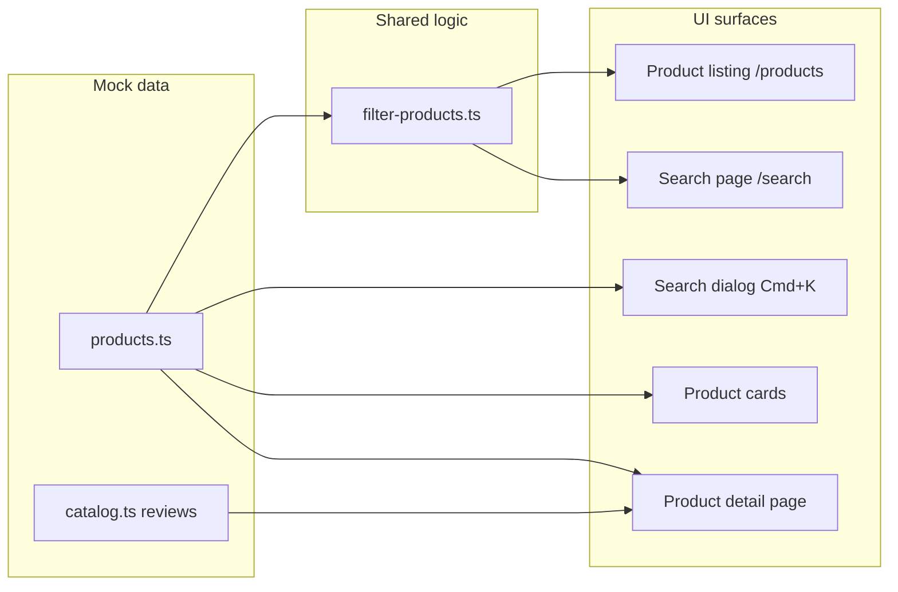
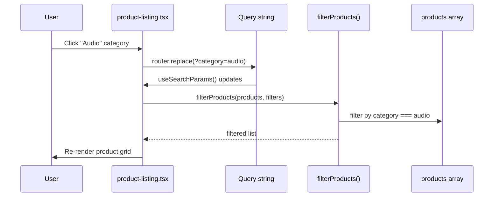

# Nova — Code Overview: Rating, Search & Filtering

This document explains how the main catalog logic works in TypeScript/JavaScript: **ratings**, **search**, and **product filtering**. All of it runs in the browser against mock data — there is no API or database.

---

## Architecture at a glance



| Feature | Core file(s) | Where it appears |
|---------|--------------|------------------|
| **Filtering & sort** | `lib/filter-products.ts` | `/products`, `/search` |
| **Filter UI + URL sync** | `components/product/product-listing.tsx` | `/products` |
| **Search (page)** | `app/(storefront)/search/page.tsx` | `/search?q=…` |
| **Search (dialog)** | `components/navigation/search-dialog.tsx` | Header, `Ctrl/Cmd + K` |
| **Rating display** | `components/product/rating-stars.tsx` | Cards, PDP, admin |
| **Review data** | `lib/data/catalog.ts` → `reviewsFor()` | Product detail page |

---

## 1. Rating

Ratings in Nova are **static mock values** on each product plus optional individual review records. Nothing is calculated from user input at runtime.

### Data model

Each product in `lib/data/products.ts` has:

```typescript
rating: number;        // e.g. 4.8 — average score shown in UI
reviewCount: number;   // e.g. 1284 — total reviews label
```

Individual reviews live in `lib/data/catalog.ts`:

```typescript
{
  id: "r1",
  productId: "pulse",
  author: "Maya Chen",
  rating: 5,
  title: "The commute disappeared.",
  body: "...",
  date: "2026-06-12",
  verified: true,
}
```

### `reviewsFor(productId)` — lookup helper

```typescript
// lib/data/catalog.ts
export function reviewsFor(productId: string) {
  return reviews.filter((r) => r.productId === productId);
}
```

Used on the product detail page to list written reviews for that product.

### `RatingStars` — display component

**File:** `components/product/rating-stars.tsx`

This is a **presentational** component. It does not fetch or compute ratings — it only renders what it receives.

| Prop | Type | Purpose |
|------|------|---------|
| `rating` | `number` | Score 0–5 (supports half stars at `.5`) |
| `count` | `number?` | Review count; optional |
| `size` | `"sm" \| "md"` | Icon and text size |
| `compact` | `boolean` | `4.8 (1,284)` vs `4.8 · 1,284 reviews` |

**How stars are drawn:**

```typescript
Array.from({ length: 5 }, (_, i) => {
  const filled = rating >= i + 1;           // full star
  const half = !filled && rating >= i + 0.5; // half star (filled style)
  // render Star icon filled or outline
});
```

**Where it is used:**

- `product-card.tsx` — under featured and standard cards
- `product-detail.tsx` — summary + each review row
- `admin/reviews/page.tsx` — admin review table

### Rating as a filter

Filtering by rating is **not** in `RatingStars`. It lives in `filterProducts()`:

```typescript
if (filters.minRating) {
  list = list.filter((p) => p.rating >= filters.minRating!);
}
```

On `/products`, the user can pick **4+ stars** or **3+ stars**; that sets `?rating=4` or `?rating=3` in the URL.

---

## 2. Search

Nova has **two search experiences** that work differently.

### A. Search dialog (quick navigation)

**File:** `components/navigation/search-dialog.tsx`

- Opened from the header search icon or **`Ctrl/Cmd + K`**
- Uses the **Command** component (cmdk-style palette)
- Lists **all products** upfront; filtering happens inside the command UI as you type
- Each item’s `value` is `"${p.name} ${p.tagline} ${p.category}"` so typing matches name, tagline, or category
- **Selecting a result** navigates directly to `/products/[slug]` — not the search results page

```typescript
onSelect={() => {
  setSearchOpen(false);
  router.push(`/products/${p.slug}`);
}}
```

Open/close state is stored in `cart-store` (`searchOpen`, `setSearchOpen`) alongside cart UI state.

### B. Search results page

**File:** `app/(storefront)/search/page.tsx`

- URL-driven: `/search?q=headphones`
- Reads `q` from query string via `useSearchParams()`
- Passes query into shared filter engine:

```typescript
const q = params.get("q") ?? "";
const list = filterProducts(products, { q, sort: "featured" });
```

- Renders a grid of `ProductCard` components or `EmptySearch` if nothing matches

### Search matching logic (shared)

**File:** `lib/filter-products.ts`

```typescript
if (filters.q) {
  const q = filters.q.toLowerCase();
  list = list.filter(
    (p) =>
      p.name.toLowerCase().includes(q) ||
      p.tagline.toLowerCase().includes(q) ||
      p.category.includes(q)
  );
}
```

Case-insensitive substring match on **name**, **tagline**, and **category**. Description and specs are not searched.

---

## 3. Filtering & sorting

All catalog filtering and sorting is centralized in one pure function.

### `ProductFilters` type

**File:** `lib/filter-products.ts`

```typescript
export type ProductFilters = {
  category?: ProductCategory | "all";
  minPrice?: number;
  maxPrice?: number;
  colors?: string[];       // color names, e.g. ["Graphite", "Sand"]
  minRating?: number;      // 3 or 4
  availability?: "all" | "in-stock" | "out-of-stock";
  q?: string;              // search query
  sort?: SortOption;
};
```

### `filterProducts(products, filters)` — pipeline

Pure function: **input array → filtered/sorted array**. Does not mutate the original list.

| Step | Condition | Effect |
|------|-----------|--------|
| 1 | `q` | Text search (name, tagline, category) |
| 2 | `category` | Match `audio`, `wearables`, `lighting`, or `power` |
| 3 | `minPrice` / `maxPrice` | Price range (inclusive) |
| 4 | `colors[]` | Product has at least one matching color name |
| 5 | `minRating` | `product.rating >= minRating` |
| 6 | `availability` | `stock > 0` or `stock <= 0` |
| 7 | `sort` | Re-order list (see below) |

### Sort options

| `sort` value | Behavior |
|--------------|----------|
| `featured` (default) | Featured first, then by rating |
| `newest` | `newest` flag, then name |
| `price-asc` | Lowest price first |
| `price-desc` | Highest price first |
| `best-selling` | `bestSeller` flag, then review count |

---

## 4. Filter UI & URL sync

**File:** `components/product/product-listing.tsx`

The products page connects UI controls to `filterProducts()` through the URL query string so filters are **shareable and bookmarkable**.

### `useListingFilters()` hook

1. **Read** current filters from `useSearchParams()`:

| URL param | Filter field | Example |
|-----------|--------------|---------|
| `category` | `category` | `?category=audio` |
| `min` | `minPrice` | `?min=50` |
| `max` | `maxPrice` | `?max=300` |
| `color` | `colors` | `?color=Graphite,Sand` |
| `rating` | `minRating` | `?rating=4` |
| `stock` | `availability` | `?stock=in-stock` |
| `sort` | `sort` | `?sort=price-asc` |
| `q` | `q` | `?q=pulse` |

2. **Write** filters with `set(patch)` — merges patch, builds new `URLSearchParams`, calls `router.replace()` with `scroll: false` so the page does not jump.

Example: selecting **Audio** category updates URL to `/products?category=audio` and re-renders the grid.

### UI helpers in the same file

| Function | Role |
|----------|------|
| `FilterPanel` | Collapsible sidebar / mobile drawer controls |
| `ActiveFilterChips` | Removable chips above grid for active filters |
| `countActiveFilters()` | Badge count on mobile Filters button |
| `clearAllFilters()` | Reset all filters to defaults |

### End-to-end flow (products page)



---

## 5. File reference

```
lib/
├── filter-products.ts      # filterProducts(), ProductFilters type
├── types.ts                # Product, Review, SortOption types
└── data/
    ├── products.ts         # Product catalog (rating, reviewCount per product)
    └── catalog.ts          # reviews[], reviewsFor()

components/
├── product/
│   ├── rating-stars.tsx    # Star rating display
│   └── product-listing.tsx # Filter UI + useListingFilters()
└── navigation/
    └── search-dialog.tsx   # Cmd+K search palette

app/(storefront)/
└── search/page.tsx         # /search?q= results page
```

---

## 6. What is not implemented

- No live star ratings or review submission from customers
- No full-text search index (simple `includes()` only)
- No server-side filtering or pagination
- Search dialog and search page use different UX (direct to PDP vs results grid)
- Filter state is not persisted to `localStorage` — only reflected in the URL on `/products`

---

## 7. Quick examples

**Filter audio products under $200, 4+ stars:**

```
/products?category=audio&max=200&rating=4
```

**Search for pulse in code:**

```typescript
import { products } from "@/lib/data";
import { filterProducts } from "@/lib/filter-products";

const results = filterProducts(products, {
  q: "pulse",
  sort: "featured",
});
```

**Get reviews for a product:**

```typescript
import { reviewsFor } from "@/lib/data";

const reviews = reviewsFor("pulse");
```

**Render a rating:**

```tsx
import { RatingStars } from "@/components/product/rating-stars";

<RatingStars rating={4.8} count={1284} compact />
```
