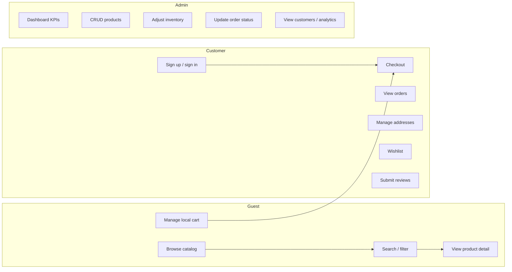
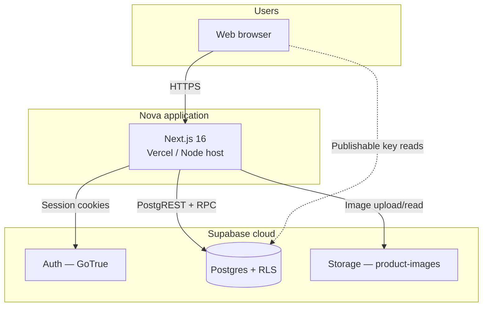
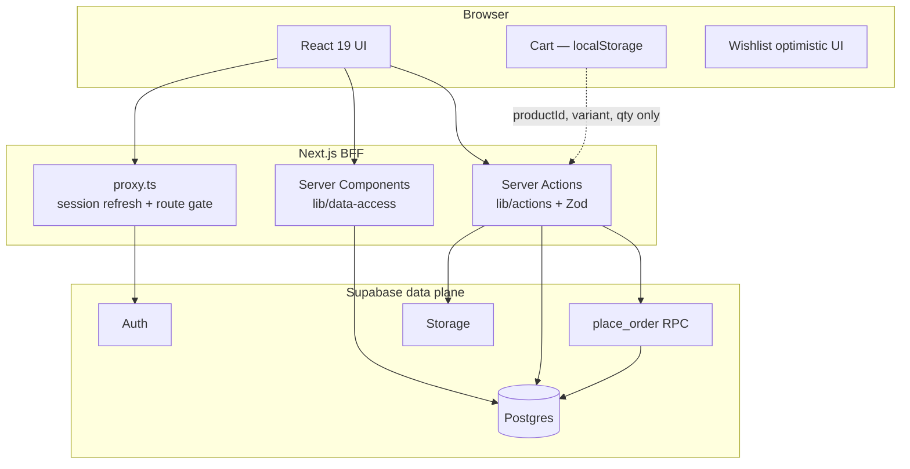
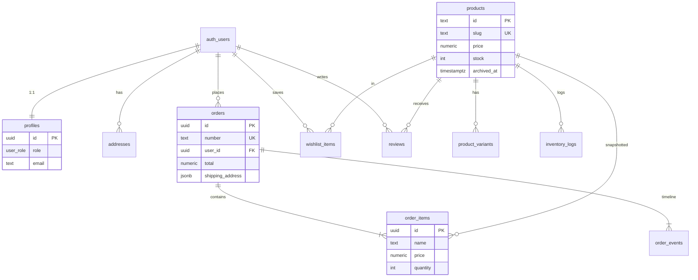
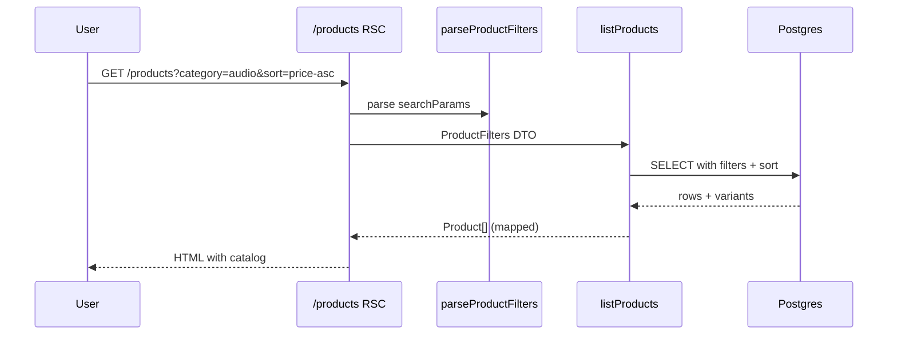
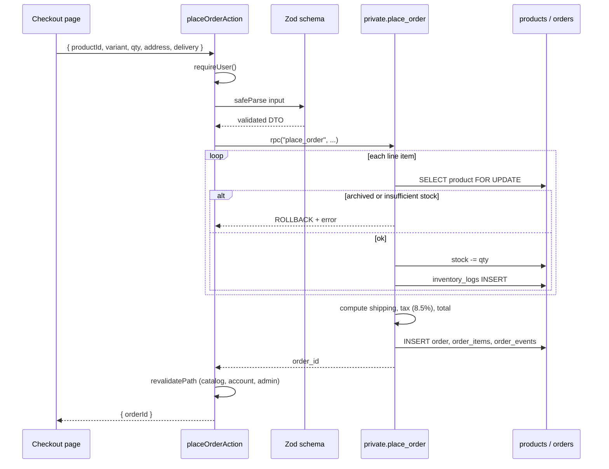
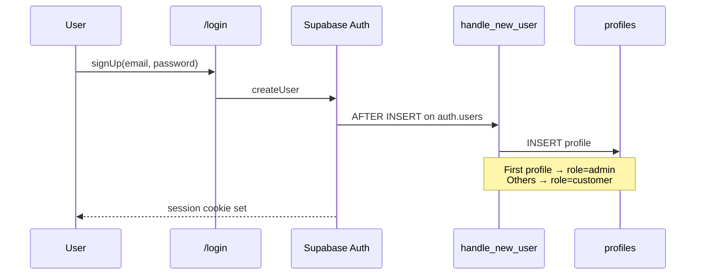
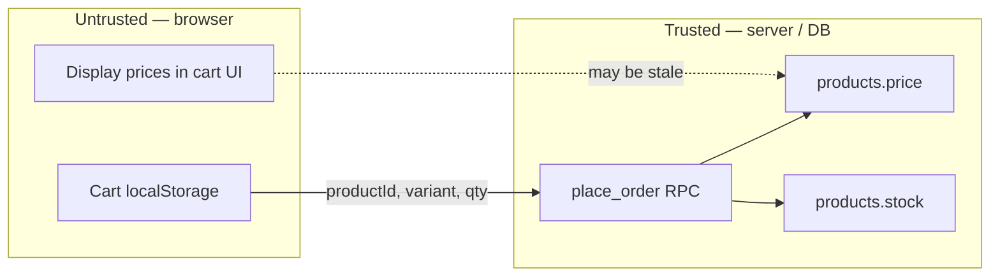
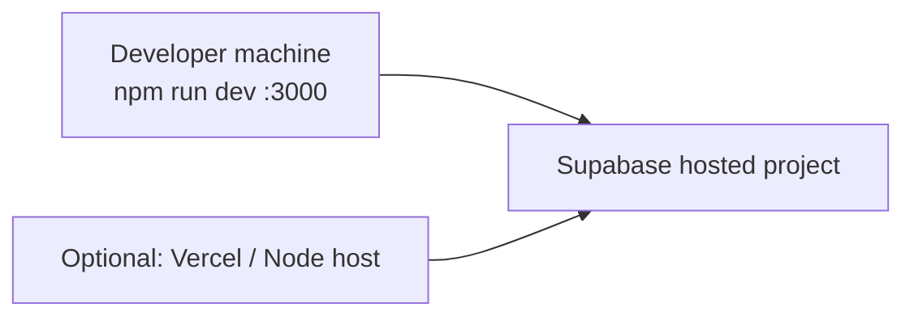
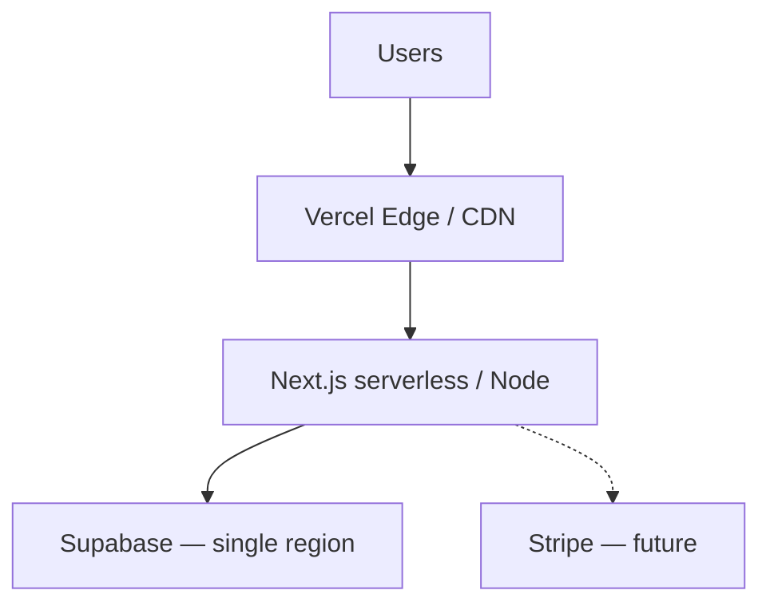

# Nova — System Design Document

System design for **Nova**, a full-stack e-commerce storefront for consumer electronics. This document describes actors, architecture, data flows, security boundaries, and trade-offs at the system level.

For backend implementation detail, see [CODE_OVERVIEW.md](./CODE_OVERVIEW.md). For interview talking points, see [INTERVIEW_GUIDE.md](./INTERVIEW_GUIDE.md). For general system design concepts, see [SYSTEM_DESIGN.md](./SYSTEM_DESIGN.md).

---

## Table of contents

1. [Executive summary](#1-executive-summary)
2. [Actors and use cases](#2-actors-and-use-cases)
3. [Requirements](#3-requirements)
4. [System context](#4-system-context)
5. [Architecture overview](#5-architecture-overview)
6. [Component design](#6-component-design)
7. [Data model](#7-data-model)
8. [Critical flows](#8-critical-flows)
9. [Client vs server state](#9-client-vs-server-state)
10. [Security architecture](#10-security-architecture)
11. [Deployment topology](#11-deployment-topology)
12. [Non-functional properties](#12-non-functional-properties)
13. [Design decisions and trade-offs](#13-design-decisions-and-trade-offs)
14. [Known limitations and evolution paths](#14-known-limitations-and-evolution-paths)
15. [Module reference](#15-module-reference)

---

## 1. Executive summary

**Nova** is a premium direct-to-consumer electronics storefront with an integrated admin back office. Customers browse a catalog, manage a guest cart, check out (sign-in required), and manage account data. Admins manage products, inventory, orders, customers, and analytics.

| Aspect | Choice |
|--------|--------|
| **Application server** | Next.js 16 (App Router) — Server Components + Server Actions |
| **System of record** | Supabase: Postgres, Auth (GoTrue), Storage |
| **Pattern** | Backend-for-Frontend (BFF) — browser never writes orders or stock directly |
| **Integrity model** | Untrusted client; prices, stock, and totals enforced in Postgres |
| **Payment** | Simulated (orders marked `paid` in the same transaction as stock decrement) |

The central engineering problem Nova solves: **how to deliver a fast guest shopping UX while guaranteeing order and inventory correctness under concurrency.**

---

## 2. Actors and use cases

### Actors

| Actor | Description | Auth |
|-------|-------------|------|
| **Guest** | Browses catalog, uses local cart, must sign in to checkout | None |
| **Customer** | Signed-in shopper with account, orders, addresses, wishlist | Supabase session (cookie) |
| **Admin** | Store operator with full back-office access | Session + `profiles.role = admin` |
| **System** | Postgres triggers, RPCs, RLS policies | N/A |

The **first registered user** is automatically promoted to admin via `private.handle_new_user()`.

### Use case map



---

## 3. Requirements

### Functional requirements

| ID | Requirement |
|----|-------------|
| FR-1 | Public product catalog with category, price, rating, and availability filters |
| FR-2 | Product detail pages with variants, specs, reviews, related products |
| FR-3 | Guest cart persisted in browser; checkout requires authentication |
| FR-4 | Order placement atomically validates stock, snapshots prices, decrements inventory |
| FR-5 | Customers see only their own orders, addresses, and wishlist |
| FR-6 | Admins manage catalog, inventory, orders, and view analytics |
| FR-7 | Reviews update product rating aggregates automatically |
| FR-8 | Verified badge on reviews when author has a paid order containing the product |

### Non-functional requirements

| ID | Requirement | Current approach |
|----|-------------|------------------|
| NFR-1 | **Data integrity** | Single Postgres transaction for checkout; `SELECT … FOR UPDATE` on stock |
| NFR-2 | **Authorization** | Layered: proxy redirects, `requireUser`/`requireAdmin`, RLS |
| NFR-3 | **Least privilege** | Publishable Supabase key only; no service role in the browser |
| NFR-4 | **Shareable catalog state** | Filters encoded in URL query params |
| NFR-5 | **Auditability** | `inventory_logs`, `order_events` timeline, price snapshots on `order_items` |
| NFR-6 | **Developer ergonomics** | Typed Supabase client, Zod at action boundary, domain mappers |

### Explicitly out of scope (current version)

- Real payment processing (Stripe, etc.)
- PCI compliance
- Email verification in production (auto-confirm for local demo)
- Edge rate limiting / WAF
- Multi-region deployment
- Guest checkout without account

---

## 4. System context

Nova sits between users and a managed Supabase backend. There is no separate REST/GraphQL API server.



**External dependencies**

| Service | Purpose |
|---------|---------|
| Supabase Auth | Email/password identity, JWT in HTTP-only cookies |
| Supabase Postgres | Catalog, orders, profiles, reviews, inventory |
| Supabase Storage | Product image assets (`product-images` bucket) |
| Google Fonts | Instrument Sans typography |

---

## 5. Architecture overview

### BFF layering

Nova uses a **Backend-for-Frontend** pattern. Next.js is the sole application tier between the browser and Supabase.



### Request lifecycle

1. **Every matched request** hits `proxy.ts`, which refreshes the Supabase session cookie and redirects unauthenticated users away from `/account`, `/admin`, and `/checkout`.
2. **Read requests** render Server Components that call `lib/data-access/*` with a cookie-bound Supabase server client.
3. **Write requests** invoke Server Actions in `lib/actions/*`: authenticate → Zod validate → mutate → `revalidatePath`.
4. **Checkout** bypasses direct table INSERT on `orders` and calls `public.place_order()` RPC instead.

### Code layering

```
app/                    Routes, layouts, page composition
  (storefront)/         Public shop
  admin/                Role-gated back office
  auth/                 Callback + password update

lib/
  supabase/             Browser, server, and middleware clients
  data-access/          Read use-cases + mappers (snake_case → domain)
  actions/              Write use-cases (auth + Zod + DB/RPC)
  stores/               Client UI state (cart, wishlist)
  types.ts              Domain model consumed by UI
  filter-products.ts    URL ↔ filter DTO

supabase/migrations/    Schema, RLS, triggers, RPCs, seed data
```

| Layer | Responsibility | Must not |
|-------|----------------|----------|
| Pages / components | Render, collect input, navigate | Embed SQL or trust client prices |
| Server Actions | Auth gate, validation, orchestration | Accept unchecked FormData |
| Data access | Query + map to domain types | Mutate orders or stock |
| Postgres | Constraints, RLS, transactions | Depend on React |
| Client stores | Cart UX, optimistic wishlist | Be source of truth for money or roles |

---

## 6. Component design

### 6.1 Storefront

| Surface | Route prefix | Data pattern |
|---------|--------------|--------------|
| Homepage | `/` | `getFeaturedProducts()` — Server Component |
| Catalog | `/products` | `listProducts(filters)` — URL-driven filters |
| Product detail | `/products/[slug]` | `getProductBySlug()` + reviews |
| Search | `/search`, Cmd+K | Same filter/query pipeline |
| Cart | `/cart` | Client `localStorage` only |
| Checkout | `/checkout` | `placeOrderAction` → RPC |
| Account | `/account/*` | `requireUser()` + RLS-scoped reads |
| Auth | `/login`, `/login/reset` | Server Actions + `/auth/callback` |

Catalog filters (`category`, `min`, `max`, `rating`, `stock`, `sort`, `q`) are **URL state**. The listing page re-queries on the server when the query string changes — shareable links and correct back-button behavior.

### 6.2 Admin dashboard

| Surface | Route | Gate |
|---------|-------|------|
| Dashboard | `/admin` | `requireAdmin()` in layout |
| Products | `/admin/products` | CRUD + archive |
| Inventory | `/admin/inventory` | Stock levels + adjustment log |
| Orders | `/admin/orders` | Status updates + timeline |
| Customers | `/admin/customers` | Profiles, spend, order history |
| Analytics | `/admin/analytics` | Revenue, orders, top products |

Admin layout (`app/admin/layout.tsx`) calls `requireAdmin()` once and redirects non-admins to `/`.

### 6.3 Authentication and session

| Concern | Implementation |
|---------|----------------|
| Identity provider | Supabase Auth (email/password) |
| Session transport | HTTP-only cookies via `@supabase/ssr` |
| Token refresh | `proxy.ts` → `getClaims()` on each request |
| Profile bootstrap | `private.handle_new_user()` trigger on `auth.users` INSERT |
| Role storage | `profiles.role` column — **not** JWT `user_metadata` |
| Callback | `/auth/callback` exchanges OAuth/code for session |

### 6.4 Supabase integration

| Client | File | Used by |
|--------|------|---------|
| Server | `lib/supabase/server.ts` | RSC, Server Actions |
| Browser | `lib/supabase/client.ts` | Rare direct client reads |
| Middleware | `lib/supabase/middleware.ts` | `proxy.ts` session refresh |

Environment exposes only `NEXT_PUBLIC_SUPABASE_URL` and `NEXT_PUBLIC_SUPABASE_PUBLISHABLE_KEY`. The service role key is never shipped to client or server runtime in this design.

---

## 7. Data model

### Entity relationship (core tables)



### Domain groupings

| Domain | Tables | Notes |
|--------|--------|-------|
| **Identity** | `profiles`, `auth.users` | Role on profile; first user = admin |
| **Catalog** | `products`, `product_variants` | Soft-delete via `archived_at` |
| **Commerce** | `orders`, `order_items`, `order_events` | Line items snapshot purchase-time data |
| **Engagement** | `reviews`, `wishlist_items` | Rating maintained by DB trigger |
| **Fulfillment** | `addresses`, `inventory_logs` | Address ownership via RLS |

### Schema-enforced invariants

- `products.stock >= 0`, `price >= 0`
- Review `rating` between 1 and 5
- `order_items.quantity > 0`
- Order line stores **name, slug, image, unit price at purchase** — catalog edits do not rewrite history
- Product `rating` / `review_count` updated by trigger on `reviews` INSERT/UPDATE/DELETE

### Indexes (query-driven)

| Index | Serves |
|-------|--------|
| `products_category_idx` | Category filter |
| `products_featured_idx` | Homepage / featured sort |
| `products_name_trgm_idx` | Fuzzy name search (`pg_trgm`) |
| `orders_user_id_idx` | Account order list |
| `orders_placed_at_idx` | Admin recent orders, analytics |
| `inventory_logs_product_id_idx` | Admin inventory history |

---

## 8. Critical flows

### 8.1 Catalog browse and filter



Search sanitizes `ilike` wildcards (`%`, `_`) before interpolation into PostgREST filters.

### 8.2 Checkout (critical write path)

The cart is **UI state**. Checkout sends only identifiers and quantities — never prices.



**Pricing rules inside `place_order`**

| Rule | Value |
|------|-------|
| Unit price | From `products.price` at transaction time |
| Standard shipping | Free if subtotal ≥ $75, else $12 |
| Express / overnight | $18 / $32 |
| Tax | 8.5% of subtotal |
| Order number | `NV-` + sequence (`private.order_number_seq`) |
| Payment status | `paid` (simulated) |

**Concurrency:** `SELECT … FOR UPDATE` serializes stock decrements. Two simultaneous checkouts of the last unit cannot both succeed.

### 8.3 Authentication bootstrap



### 8.4 Admin order fulfillment

1. Admin opens `/admin/orders/[id]` (requires `requireAdmin()`).
2. Admin updates status via `lib/actions/admin.ts`.
3. App writes to `orders` and appends `order_events` for timeline.
4. RLS allows admin writes; customers cannot mutate order status.

### 8.5 Review submission

1. Customer submits review via `submitReviewAction`.
2. Server validates rating/title/body with Zod.
3. Postgres trigger `refresh_product_rating` recalculates `products.rating` and `review_count`.
4. Verified flag set when author has a **paid** order containing the product.

---

## 9. Client vs server state

Nova deliberately splits state by trust level.

| State | Location | Trusted for | Not trusted for |
|-------|----------|-------------|-----------------|
| **Cart items** | `localStorage` (`nova-cart`) | UX, display subtotals | Final price, stock at checkout |
| **Wishlist** | Postgres + optimistic UI | Persistence | N/A |
| **Session / role** | HTTP-only cookies + `profiles` | Authorization | N/A |
| **Catalog** | Postgres | Price, stock, availability | N/A |
| **Filter UI** | URL query string | Shareable navigation | N/A |



At checkout, the server **re-reads** authoritative price and stock. A stale cart price in the UI does not affect the order total.

---

## 10. Security architecture

Defense in depth: a bug in one layer should not expose the full database.

### Authorization layers

| Layer | Mechanism | Protects |
|-------|-----------|----------|
| **Route proxy** | Redirect if no session on protected paths | `/account`, `/admin`, `/checkout` |
| **Server helpers** | `requireUser()`, `requireAdmin()` | Actions and admin pages |
| **RLS** | Postgres policies on every public table | Direct PostgREST access |
| **Role trigger** | `prevent_role_escalation()` | Customer cannot set `role = admin` |
| **RPC grants** | `place_order` EXECUTE for `authenticated` only | Anonymous order creation |

### Key security properties

- Customers **cannot INSERT** into `orders` directly — only `place_order` can, under controlled `SECURITY DEFINER` logic.
- Public catalog is **read-only** for non-admins (`archived_at IS NULL` filter for customers).
- **Ownership policies** on addresses, wishlist, orders, reviews (`user_id = auth.uid()`).
- **Storage bucket** `product-images`: public read, admin write.
- **Open-redirect guard** on auth callback `next` param: must start with `/`, no `//` or `://`.
- **`private.is_admin()`** is `SECURITY DEFINER` for RLS policy checks without recursive policy issues.

### What Nova does not claim

- PCI-compliant payments
- Production-grade email verification (auto-confirm is a demo choice)
- Edge rate limiting or bot protection
- Secrets rotation or audit log export

---

## 11. Deployment topology

### Current (development / demo)



| Component | Host | Config |
|-----------|------|--------|
| Next.js app | Local `:3000` or Vercel | `NEXT_PUBLIC_SUPABASE_*` in `.env.local` |
| Postgres + Auth | Supabase cloud | Migrations in `supabase/migrations/` |
| Product images | Supabase Storage | Public bucket |

### Production-shaped deployment (recommended evolution)



- Static assets and RSC payloads served from CDN edge.
- Server Actions and RSC run on the compute platform (Vercel, etc.).
- Supabase remains the data plane; connection pooling via Supavisor for serverless.

---

## 12. Non-functional properties

### Scalability (current scale assumptions)

Nova targets a **single-region, moderate-traffic** storefront — appropriate for demo and small production.

| Dimension | Current capacity | Bottleneck at scale |
|-----------|------------------|---------------------|
| Read traffic | Server Components + Postgres indexes | DB connection count on serverless |
| Write traffic | Single Postgres primary | Checkout row locks on hot SKUs |
| Storage | Supabase managed Postgres | Image storage in single bucket |
| Search | `ilike` + trigram | Full-text / dedicated search engine at large catalog size |

### Reliability

| Concern | Mitigation |
|---------|------------|
| Partial checkout failure | Single transaction — all-or-nothing |
| Overselling last unit | `FOR UPDATE` + stock check in same TX |
| Stale session | Proxy refreshes tokens on every request |
| Orphan profile | `ensureProfile()` fallback in `getSessionUser()` |

### Observability (gaps)

Current project has no dedicated metrics, tracing, or structured logging pipeline. Production would add:

- Request/error rates on Server Actions
- Checkout failure reasons from RPC exceptions
- Supabase dashboard for slow queries and connection usage

---

## 13. Design decisions and trade-offs

| Decision | Alternative considered | Rationale |
|----------|------------------------|-----------|
| Next.js as BFF | Separate Express API + SPA | One deployable; colocated mutations; HTTP-only cookies |
| RLS + actions | Service role bypassing RLS | Leaked action cannot become god-mode DB client |
| Cart in `localStorage` | Server-side cart table | No auth required to shop; trust recovered at checkout |
| Order in Postgres RPC | Multi-step app transaction | Atomic stock + order; no ORM race conditions |
| Role on `profiles` | JWT `user_metadata.role` | Metadata is user-editable — not an auth source |
| Soft-archive products | Hard delete | Order history keeps valid FK references |
| Rating via DB trigger | AVG in every listing query | Simple, fast catalog reads |
| Zod at action boundary | Trust client JSON | Clear errors; independent of RLS |
| Simulated payment | Stripe integration | Scope focused on inventory/order integrity |

---

## 14. Known limitations and evolution paths

### Current limitations

1. **Payment is mocked** — `place_order` marks orders `paid` in the same transaction as stock decrement. Real systems separate authorization, capture, and fulfillment.
2. **No idempotency key on checkout** — network retries could theoretically double-charge intent (mitigated by redirect-after-success UX, not by server dedup).
3. **No guest checkout** — friction for conversion; simplifies ownership model.
4. **Single Postgres primary** — no read replicas or sharding in current design.
5. **Search is Postgres-only** — adequate for hundreds of SKUs; would need Elasticsearch/Typesense at large scale.
6. **First-user-admin bootstrap** — convenient for demo; production needs invite-based or manual role assignment.

### Evolution roadmap

| Phase | Enhancement |
|-------|-------------|
| **Payments** | Stripe PaymentIntent + webhook; order status `pending` until `payment_intent.succeeded` |
| **Inventory** | Reserve stock on checkout start; release on payment timeout |
| **Scale reads** | Read replica for catalog; CDN for product images |
| **Scale writes** | Queue for analytics aggregation; partition `orders` by date |
| **Ops** | Rate limiting at edge; structured logging; SLO on checkout success rate |
| **Features** | Coupons (schema existed, dropped in migration), email notifications, multi-currency |

---

## 15. Module reference

Quick map from system concern to code.

| Concern | Location |
|---------|----------|
| Route gate / session refresh | `proxy.ts`, `lib/supabase/middleware.ts` |
| Server Supabase client | `lib/supabase/server.ts` |
| Auth helpers | `lib/data-access/auth.ts` |
| Auth actions | `lib/actions/auth.ts` |
| Auth callback | `app/auth/callback/route.ts` |
| Catalog reads | `lib/data-access/products.ts`, `lib/filter-products.ts` |
| Order reads | `lib/data-access/orders.ts` |
| Checkout write | `lib/actions/checkout.ts` → `public.place_order` RPC |
| Admin reads / writes | `lib/data-access/admin.ts`, `lib/actions/admin.ts` |
| Reviews / wishlist / addresses | `lib/actions/reviews.ts`, `wishlist.ts`, `addresses.ts` |
| Cart client state | `lib/stores/cart-store.tsx` |
| Domain types | `lib/types.ts` |
| DB → domain mapping | `lib/data-access/mappers.ts` |
| Schema, RLS, RPCs | `supabase/migrations/20260813120000_init_schema.sql` |

---

## Appendix: Route map

### Storefront

| Route | Auth | Primary data source |
|-------|------|---------------------|
| `/` | Public | Featured products |
| `/products` | Public | Filtered catalog |
| `/products/[slug]` | Public | Product + reviews |
| `/search` | Public | Search query |
| `/cart` | Public | localStorage |
| `/checkout` | Required | User profile, addresses |
| `/account/*` | Required | Orders, profile, wishlist |
| `/login` | Public (redirect if signed in) | — |

### Admin

| Route | Auth | Primary data source |
|-------|------|---------------------|
| `/admin` | Admin | Dashboard KPIs |
| `/admin/products` | Admin | Product CRUD |
| `/admin/orders` | Admin | Order management |
| `/admin/inventory` | Admin | Stock + logs |
| `/admin/customers` | Admin | Customer profiles |
| `/admin/analytics` | Admin | Revenue aggregates |

---

*Nova's system design centers on one principle: the browser is fast but untrusted; Postgres is slow to change but authoritative. Everything else — BFF layering, RLS, RPC checkout — follows from that split.*
