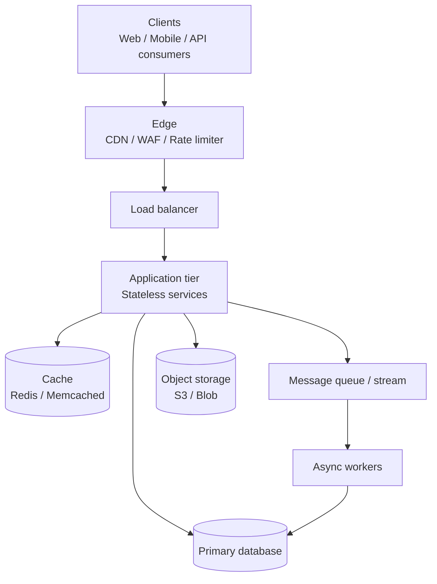
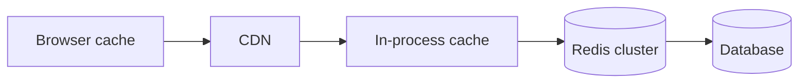
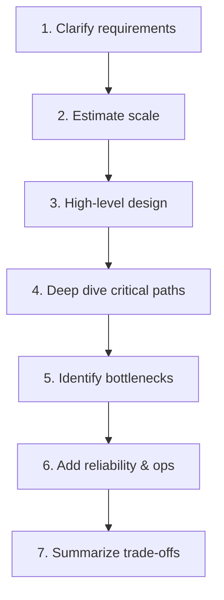

# System Design — Core Concepts

A practical reference for designing large-scale software systems. These concepts apply across web apps, APIs, data platforms, and distributed services.

---

## Table of contents

1. [What system design is](#1-what-system-design-is)
2. [Requirements](#2-requirements)
3. [Capacity estimation](#3-capacity-estimation)
4. [High-level architecture](#4-high-level-architecture)
5. [Core building blocks](#5-core-building-blocks)
6. [Scalability](#6-scalability)
7. [Data storage](#7-data-storage)
8. [Caching](#8-caching)
9. [Communication patterns](#9-communication-patterns)
10. [Reliability and availability](#10-reliability-and-availability)
11. [Consistency models](#11-consistency-models)
12. [Security fundamentals](#12-security-fundamentals)
13. [Observability](#13-observability)
14. [Common architectural patterns](#14-common-architectural-patterns)
15. [Design process checklist](#15-design-process-checklist)
16. [Glossary](#16-glossary)

---

## 1. What system design is

**System design** is the process of defining how components (services, databases, queues, caches, clients) interact to meet **functional** and **non-functional** requirements at a target scale.

Good design balances:

| Goal | Question it answers |
|------|---------------------|
| **Correctness** | Does it do the right thing? |
| **Scalability** | Can it handle growth in users, data, and traffic? |
| **Reliability** | Does it keep working when parts fail? |
| **Performance** | Is latency and throughput acceptable? |
| **Maintainability** | Can teams evolve it safely over time? |
| **Cost** | Is the solution proportionate to the business value? |

System design is rarely about finding one perfect answer. It is about **making explicit trade-offs** and documenting assumptions.

---

## 2. Requirements

Always clarify requirements before drawing boxes.

### Functional requirements

What the system **must do**:

- Users can post a message
- Search returns ranked results within 200 ms
- Payments are idempotent (retry-safe)

### Non-functional requirements (NFRs)

How well the system must perform:

| NFR | Typical targets | Notes |
|-----|-----------------|-------|
| **Latency** | p50 / p95 / p99 | Tail latency matters for UX |
| **Throughput** | requests/sec, events/sec | Peak vs average |
| **Availability** | 99.9% ("three nines") | ~8.7 h downtime/year |
| **Durability** | No data loss after ack | Backups, replication |
| **Consistency** | Strong vs eventual | See [§11](#11-consistency-models) |
| **Security** | AuthN, AuthZ, encryption | See [§12](#12-security-fundamentals) |

### Scope boundaries

Define what is **in** and **out** of scope:

- In scope: read path, write path, auth
- Out of scope: ML ranking v2, multi-region active-active (phase 2)

---

## 3. Capacity estimation

Back-of-the-envelope math prevents designs that cannot physically work.

### Useful units

- 1 day ≈ 86,400 seconds ≈ **100K seconds** (round for mental math)
- 1 MB ≈ 10⁶ bytes; 1 GB ≈ 10⁹ bytes
- Average QPS ≈ `daily_requests / 100,000`
- Peak QPS ≈ `2–5 × average` (depends on traffic shape)

### Example: URL shortener

Assumptions:

- 100M URLs/month created → ~40 writes/sec average, ~200/sec peak
- 10:1 read:write ratio → ~400 reads/sec average, ~2K/sec peak
- 500 bytes per stored URL record → 100M × 500 B ≈ **50 GB** metadata/year

These numbers drive choices: a single Postgres can handle this; you may still add caching for hot links.

### Storage, bandwidth, memory

| Resource | Formula (conceptual) |
|----------|----------------------|
| Storage | `records × record_size × retention` |
| Write bandwidth | `write_qps × payload_size` |
| Cache size | `hot_key_fraction × working_set` |

Estimation does not need to be exact. Order-of-magnitude correctness is enough to choose between options.

---

## 4. High-level architecture

Most systems decompose into layers:

### Stateless vs stateful

- **Stateless app servers** scale horizontally easily; session state lives in cookies, JWT, or external store.
- **Stateful components** (databases, single-leader queues) need replication, sharding, or clustering.

### Separation of concerns

| Layer | Responsibility |
|-------|----------------|
| **Presentation** | UI, API gateway, protocol translation |
| **Application / domain** | Business rules, orchestration |
| **Data** | Persistence, indexing, analytics |

---

## 5. Core building blocks

### Load balancer

Distributes traffic across healthy instances.

- **Algorithms:** round-robin, least connections, consistent hashing (sticky sessions)
- **Layers:** L4 (TCP) vs L7 (HTTP, path-based routing)
- **Health checks:** remove unhealthy nodes automatically

### Reverse proxy / API gateway

Single entry point for clients:

- TLS termination, routing, auth, rate limiting, request aggregation
- Examples: NGINX, Envoy, Kong, AWS API Gateway

### CDN (Content Delivery Network)

Caches static and cacheable dynamic content **close to users**.

- Best for: images, JS/CSS, video, some API responses with `Cache-Control`
- Reduces origin load and latency

### DNS

Maps hostnames to IPs; also used for **geo routing** and **failover** (lower TTL during migrations).

---

## 6. Scalability

### Vertical vs horizontal scaling

| Approach | Pros | Cons |
|----------|------|------|
| **Vertical** (bigger machine) | Simple | Hard upper bound, single point of failure |
| **Horizontal** (more machines) | Elastic, fault tolerant | Needs load balancing, distributed data |

Prefer **horizontal scaling** for the application tier; combine with **sharding** for data tier.

### Scaling dimensions

- **Scale up:** CPU/RAM on one node
- **Scale out:** more nodes
- **Scale read:** replicas, caches
- **Scale write:** partitioning, async pipelines, separate write path

### Bottleneck hunting

Common limits:

1. Single database primary (write throughput)
2. Hot keys in cache or DB
3. Synchronous chains (A → B → C on critical path)
4. Large payloads / N+1 queries
5. Lock contention

---

## 7. Data storage

### SQL (relational)

**Use when:** structured data, joins, transactions, strong integrity.

- **Pros:** ACID, mature tooling, flexible queries
- **Cons:** harder to scale writes; schema migrations need care

Examples: PostgreSQL, MySQL.

### NoSQL

| Type | Good for | Examples |
|------|----------|----------|
| **Key-value** | Sessions, caches, simple lookups | Redis, DynamoDB |
| **Document** | Flexible schemas, nested JSON | MongoDB, CouchDB |
| **Wide-column** | High write volume, time series | Cassandra, HBase |
| **Graph** | Relationships, recommendations | Neo4j |

Choose by **access patterns**, not hype.

### Indexing

Indexes speed reads but slow writes and use storage.

- B-tree indexes: range queries, sorting
- Hash indexes: equality lookups
- Composite indexes: match query column order
- Covering indexes: avoid table lookups

### Partitioning / sharding

Split data across nodes when one machine is insufficient.

| Strategy | How | Trade-off |
|----------|-----|-----------|
| **Range** | by ID or time range | hot spots on latest range |
| **Hash** | `hash(key) mod N` | even spread; range queries harder |
| **Directory / consistent hash** | lookup table or ring | rebalance when nodes added |

**Shard key** choice is critical — it should match your hottest queries and avoid hotspots.

### Replication

Copies data to multiple nodes:

- **Leader-follower (primary-replica):** writes to leader, reads from replicas
- **Multi-leader:** writes in multiple regions; conflict resolution needed
- **Leaderless (quorum):** e.g. `W + R > N` for tunable consistency

Replication improves **read scalability** and **availability**; failover and lag management add complexity.

---

## 8. Caching

Caching stores copies of expensive results closer to the consumer.

### Where to cache

### Cache strategies

| Pattern | Behavior |
|---------|----------|
| **Cache-aside** | App reads cache; on miss, read DB and populate cache |
| **Read-through** | Cache library loads from DB on miss |
| **Write-through** | Write to cache and DB together |
| **Write-back** | Write to cache; flush to DB asynchronously |

### Invalidation

> "There are only two hard things in CS: cache invalidation and naming things."

- **TTL:** simple; stale data until expiry
- **Event-driven invalidation:** precise; needs pub/sub or change streams
- **Version keys:** `product:123:v5` avoids thundering deletes

### Pitfalls

- **Cache stampede:** many requests miss at once → use locking or request coalescing
- **Hot keys:** single key overloads one Redis shard → local cache, key splitting
- **Stale reads:** acceptable for many dashboards; not for balances/inventory

---

## 9. Communication patterns

### Synchronous (request/response)

HTTP/gRPC between services.

- **Pros:** simple mental model, immediate feedback
- **Cons:** tight coupling, latency stacks, cascading failures

Mitigate with **timeouts**, **retries with backoff**, **circuit breakers**, and **bulkheads**.

### Asynchronous (message queues / streams)

Producer sends events; consumers process later.

- **Pros:** decoupling, buffering spikes, reliability
- **Cons:** complexity, eventual consistency, duplicate delivery

| Tool class | Semantics | Examples |
|------------|-----------|----------|
| **Queue** | work distribution, often at-least-once | SQS, RabbitMQ |
| **Log / stream** | ordered replay, multiple consumers | Kafka, Kinesis |
| **Pub/sub** | fan-out notifications | SNS, Redis Pub/Sub |

### Delivery guarantees

- **At-most-once:** may lose messages; simplest
- **At-least-once:** may duplicate; needs **idempotent** consumers
- **Exactly-once:** hard end-to-end; often simulated with idempotency keys + dedup store

### Idempotency

Same request applied twice has the same effect as once.

- Use idempotency keys on payments, order creation, webhooks
- Store `(key → result)` with TTL

---

## 10. Reliability and availability

### Definitions

- **Availability:** fraction of time system is usable → `uptime / (uptime + downtime)`
- **Reliability:** probability of failure-free operation over time
- **Fault tolerance:** continues operating (possibly degraded) when components fail
- **Disaster recovery:** restore service after major outage

### Redundancy

Eliminate single points of failure (SPOF):

- Multiple app instances behind LB
- DB with automatic failover replica
- Multi-AZ deployment within a region

### Failure modes

| Failure | Mitigation |
|---------|------------|
| Instance crash | Health checks, auto-restart, LB drain |
| Dependency timeout | Timeouts, fallbacks, circuit breaker |
| Traffic spike | Autoscaling, queue buffering, rate limits |
| Data center loss | Multi-region backups, runbooks, RTO/RPO targets |
| Split brain | Quorum, fencing, careful failover |

### RTO and RPO

- **RTO (Recovery Time Objective):** max acceptable downtime
- **RPO (Recovery Point Objective):** max acceptable data loss window

### SLI, SLO, SLA

- **SLI:** measured metric (e.g. successful requests / total)
- **SLO:** internal target (e.g. 99.95% success over 30 days)
- **SLA:** contractual commitment with consequences

Design error budgets: if you burn budget on incidents, slow feature velocity and invest in stability.

---

## 11. Consistency models

In distributed systems, replicas cannot always agree instantly.

### CAP theorem (simplified)

When a network partition occurs, you cannot simultaneously have:

- **Consistency** — every read sees latest write
- **Availability** — every request gets a response
- **Partition tolerance** — system works despite network splits

Real systems choose **CP** (strong consistency, may reject requests) or **AP** (stay available, may return stale data).

### PACELC extension

Even without partitions, there is a latency vs consistency trade-off.

### Practical levels

| Model | Description | Example use |
|-------|-------------|-------------|
| **Strong** | Reads reflect latest write | Bank balance, inventory checkout |
| **Eventual** | Replicas converge over time | Social likes, view counts |
| **Read-your-writes** | User sees own updates | Profile edit |
| **Monotonic reads** | No time travel on repeated reads | Feed pagination |

### Transactions

- **ACID** (single DB): Atomicity, Consistency, Isolation, Durability
- **Distributed transactions (2PC):** coordinated commit; fragile at scale
- **Saga pattern:** sequence of local transactions + compensating actions

For high scale, prefer **single-service transactions** + **eventual consistency** across boundaries.

---

## 12. Security fundamentals

Security is a cross-cutting NFR, not an afterthought.

| Area | Practices |
|------|-----------|
| **Authentication** | OAuth 2.0 / OIDC, MFA, secure session handling |
| **Authorization** | RBAC, ABAC, least privilege, row-level security |
| **Transport** | TLS everywhere |
| **Secrets** | Vault / KMS; never in source code |
| **Input validation** | Schema validation, parameterized queries |
| **Rate limiting** | Per IP, per user, per API key |
| **Audit logging** | Who did what, when, on sensitive data |

### Zero trust (modern default)

- Verify every request
- Assume breach; segment networks
- Short-lived credentials

---

## 13. Observability

You cannot operate what you cannot see.

### Three pillars

| Pillar | Purpose | Examples |
|--------|---------|----------|
| **Metrics** | Aggregated health & SLOs | Prometheus, Datadog |
| **Logs** | Discrete events, debugging | ELK, CloudWatch |
| **Traces** | End-to-end request path | OpenTelemetry, Jaeger |

### What to instrument

- Request rate, error rate, duration (RED method)
- Saturation: CPU, memory, queue depth, DB connections
- Business metrics: signups, orders, payment failures

### Alerting

Alert on **symptoms** (SLO burn, user-visible errors), not every blip. Runbooks link alerts to mitigation steps.

---

## 14. Common architectural patterns

### Monolith

Single deployable unit.

- **Pros:** simple dev/debug, ACID in one DB, low ops overhead
- **Cons:** scaling limits, coupling, slow releases at large team size

**Start here** unless you have clear reasons not to.

### Microservices

Independently deployable services around business capabilities.

- **Pros:** team autonomy, polyglot stacks, isolated scaling
- **Cons:** distributed complexity, data consistency, operational cost

Use when organizational scale or domain boundaries justify the overhead.

### Event-driven architecture

Services react to events instead of direct calls.

- Good for: audit trails, async workflows, decoupling
- Needs: schema registry, versioning, idempotent handlers

### CQRS (Command Query Responsibility Segregation)

Separate **write model** from **read model**.

- Writes optimized for integrity; reads optimized for queries (denormalized views)
- Often paired with event sourcing for audit/replay

### BFF (Backend for Frontend)

Dedicated API layer per client type (web vs mobile).

- Shapes responses for each client; hides internal microservice sprawl

### Strangler fig

Gradually replace legacy system by routing traffic to new components over time.

---

## 15. Design process checklist

Use this flow in interviews and real projects:

### Step-by-step

1. **Clarify** functional + non-functional requirements; define scope.
2. **Estimate** QPS, storage, bandwidth; note peak vs average.
3. **Sketch** clients, API, data stores, async workers, external deps.
4. **Detail** read path, write path, and one hard scenario (search, feed, payment).
5. **Scale** with caching, sharding, replication, queues as needed.
6. **Harden** with redundancy, backups, monitoring, security, runbooks.
7. **Trade-offs** — state what you optimized for and what you deferred.

### Questions to ask stakeholders

- Who are the users and where are they geographically?
- Read-heavy or write-heavy? Real-time or batch?
- Consistency requirements on money, inventory, analytics?
- Expected growth in 1 year? 3 years?
- Compliance (GDPR, PCI, HIPAA)?

---

## 16. Glossary

| Term | Meaning |
|------|---------|
| **Latency** | Time to complete one operation |
| **Throughput** | Operations completed per unit time |
| **Hot spot** | Uneven load on one shard/key/node |
| **Thundering herd** | Many clients retry or refresh simultaneously |
| **Backpressure** | Slowing producers when consumers are overloaded |
| **Circuit breaker** | Stop calling failing dependency temporarily |
| **Graceful degradation** | Reduced functionality instead of total failure |
| **Blast radius** | Scope of impact when something fails |
| **Eventual consistency** | All replicas agree given enough time |
| **Idempotency key** | Client token ensuring safe retries |
| **Quorum** | Minimum votes needed for read/write success |
| **Fan-out** | One event triggers many downstream actions |
| **Denormalization** | Duplicate data to speed reads |
| **Cold start** | Delay when scaling new instances from zero |

---

## Quick reference: classic system categories

When practicing, map concepts to familiar systems:

| System | Key challenges |
|--------|----------------|
| **URL shortener** | Key generation, redirects, analytics, hot links |
| **Twitter / feed** | Fan-out on write vs read, ranking, celebrity problem |
| **Chat / WhatsApp** | Real-time delivery, presence, message ordering |
| **Video (YouTube)** | Upload pipeline, transcoding, CDN, recommendations |
| **Ride sharing (Uber)** | Geospatial indexes, matching, surge pricing |
| **E-commerce** | Inventory consistency, cart, checkout idempotency, search |
| **Rate limiter** | Token bucket, sliding window, distributed counters |
| **Notification service** | Multi-channel delivery, preferences, retries |

---

## Further reading

- *Designing Data-Intensive Applications* — Martin Kleppmann (consistency, replication, streams)
- AWS / Google Cloud architecture frameworks — well-architected pillars
- OpenTelemetry docs — modern observability standards
- Company engineering blogs (Netflix, Uber, Meta) — real-world trade-offs

---

*This document is a general reference. Adapt concepts to your product's scale, team size, and constraints — the best design is the simplest one that meets requirements with room to grow.*
